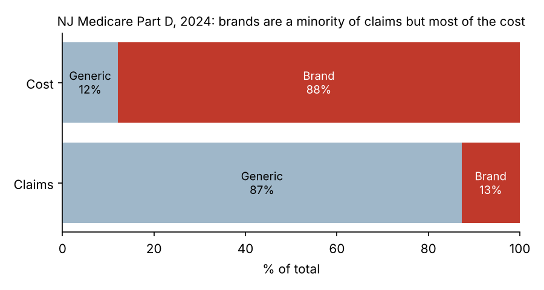
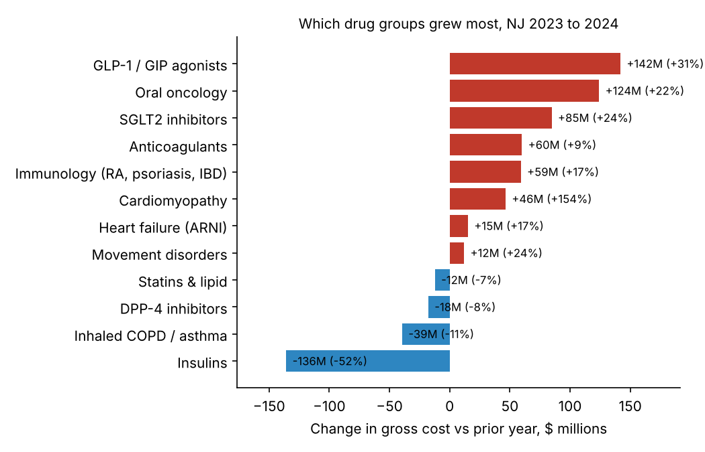

# Medicare Part D Drug Spend: A PBM Analytics Case Study (New Jersey, 2023–2024)

What drives prescription drug spending for Medicare patients in New Jersey, where is it growing, and where could a pharmacy benefit manager (PBM) act? This project answers those questions with SQL (PostgreSQL) and Python on public CMS claims data, the way a PBM analytics team would frame them for formulary and clinical leaders.

**Data:** CMS [Medicare Part D Prescribers – by Provider and Drug](https://data.cms.gov/provider-summary-by-type-of-service/medicare-part-d-prescribers/medicare-part-d-prescribers-by-provider-and-drug), New Jersey, data years 2023 and 2024: 1.37 million prescriber-drug rows, about 30,000 prescribers, 36 million claims and **$6.26 billion** in 2024 gross drug cost.

> All dollar figures are **gross** drug costs (plan + patient + other payers) **before manufacturer rebates**. Brand-name drugs carry large rebates, so their net cost to a plan is lower than shown here. Every savings number below is therefore an upper bound.

---

## Business readout (one page)

**1. Spend is concentrated in a few brand drugs.** Brand-name products were 12.8% of 2024 claims but 87.9% of cost ($1,194 vs $24 per claim). The top 10 products are 33% of spend and the top 50 are 60%, out of 2,175 products. Eliquis alone is $556M (8.9%).
*So what:* formulary and contracting decisions on a short list of brands matter far more than anything done on the long tail of generics.

**2. Growth comes from more patients, not higher prices.** Total cost grew 5.1% (2023→2024). Claims grew 6.5% while cost per day of supply fell 1.6%. The biggest increases were GLP-1/GIP drugs (+$142M, +31%; Mounjaro alone +$105M as claims more than tripled), oral oncology (+$124M) and SGLT2 inhibitors (+$85M). Diabetes, GLP-1 and anticoagulant drugs together are 34% of all spend.
*So what:* the lever is utilization management (right patient, right drug) and adherence, not just price negotiation. The cardiometabolic class should be the first place a PBM clinical program looks.

**3. Price cuts show up clearly in the data.** Insulin spend fell 52% (−$136M) while insulin claims were flat (−1%). Lantus SoloStar spend dropped from $59M to $12M even as its claims *rose* 6%. This matches the manufacturers' list-price cuts: Sanofi cut Lantus's list price by 78% from January 1, 2024, and Novo Nordisk and Eli Lilly made similar cuts to NovoLog and Humalog. Inhaled COPD/asthma drugs fell 11% (−$39M) with claims up 5%, consistent with 2024 inhaler list-price cuts (e.g. Advair Diskus −50%, Symbicort −40%).
*So what:* gross cost trends can move for reasons outside the PBM's control. A trend report should separate volume, mix and unit price, as this project does, before giving credit or blame.

**4. Generic substitution is worth about $198M a year (gross, upper bound), and 10 molecules are 55% of it.** For molecules sold as both brand and generic, filling every brand claim at the generic's cost per day would save $198M (3.2% of spend), after removing 10 molecules where the "generic" is a different formulation (see [Decision log](docs/decision_log.md)). The largest are Revlimid → generic lenalidomide ($19.6M), Tresiba → unbranded insulin degludec ($19.0M), Myrbetriq → generic mirabegron ($16.5M) and Vascepa → generic icosapent ethyl ($11.2M).
*So what:* a targeted program on 10–25 molecules (55–75% of the opportunity) is more practical than a blanket generic push. Rebates must be checked first: some brands are cheaper *net* than their generic, which is why plans sometimes prefer the brand.

**5. A small group of prescribers is a natural outreach list.** Comparing each prescriber with peers in the same specialty, 1,180 of 15,523 prescribers (7.6%) are in the top 5% for cost per claim or for brand use on molecules that have a generic. They write 21% of the cost. 540 are flagged for brand use, a candidate list for pharmacist outreach about generic alternatives.
*So what:* a flag is a reason to look, not a finding. A high-cost prescriber may treat sicker patients, and nurse practitioners and physician assistants (the most-flagged groups) work across many specialties, so their peer group is mixed.




**Recommendation for a PBM clinical/formulary team:** (1) put cardiometabolic utilization management and adherence at the top of the 2025 trend plan; (2) run a generic-substitution review on the top 25 multi-source molecules, *net of rebates*; (3) pilot pharmacist outreach with the highest-ranked brand-flagged prescribers and measure the brand-rate change against a matched group that is not contacted.

---

## What each query answers

| # | Business question | SQL | Result |
|---|---|---|---|
| Q0 | How big is the market? | [02](sql/02_business_queries.sql) | [csv](results/q0_overview.csv) |
| Q1 / Q1b | Which drugs drive spend, and how concentrated is it? Ranking and running totals with window functions | [02](sql/02_business_queries.sql) | [csv](results/q1_top_drugs_by_spend.csv) |
| Q2 | Which drugs cost most per prescription? Cost per claim and per 30-day fill | [02](sql/02_business_queries.sql) | [csv](results/q2_unit_cost.csv) |
| Q3 | How much is brand vs generic? | [02](sql/02_business_queries.sql) | [csv](results/q3_brand_vs_generic.csv) |
| Q4 / Q4b | What is growing, and is it volume or price? Year over year with `LAG` | [02](sql/02_business_queries.sql) | [csv](results/q4_yoy_growth.csv) |
| Q5 / Q5b | What would generic substitution save? | [02](sql/02_business_queries.sql) | [csv](results/q5_generic_substitution.csv) |
| Q6 / Q7 | Spend and growth by therapeutic group, via a SQL function | [03](sql/03_therapeutic_groups.sql), [03b](sql/03b_group_queries.sql) | [csv](results/q7_spend_by_group.csv) |
| Q8 | Which prescribers stand out from their specialty peers? A rules-based flag, saved as a view | [04](sql/04_prescriber_flags.sql) | [csv](results/q8_flag_summary.csv) |

The [notebook](notebooks/partd_analysis.ipynb) recomputes the totals and the savings estimate in pandas and checks that they match the SQL to the dollar, then draws the charts.

## How it works

```
CMS API ──► scripts/download_partd.py ──► data/raw/*.csv
        ──► scripts/load_partd.py      ──► Postgres: prescriber_drug (typed, with data_year and is_brand)
        ──► scripts/run_queries.py     ──► drug_group_map + fn_drug_group() + vw_prescriber_flags
                                        ──► results/*.csv
        ──► notebooks/partd_analysis.ipynb ──► reconciliation + results/figures/*.png
```

* **`prescriber_drug`**: one row per prescriber × drug × year. `is_brand` is a generated column (the CMS file has no brand/generic field; see the decision log).
* **`fn_drug_group(gnrc_name)`**: a SQL function mapping a molecule to a therapeutic group from a lookup table of patterns. It covers 79.5% of spend; the rest is labelled "Other / unmapped".
* **`vw_prescriber_flags`**: a view with each prescriber's cost per claim and brand rate, their percentile within their specialty, and the flags. Thresholds sit in one `params` block.

## Run it

Requires Docker and Python 3.10+.

```bash
python -m venv .venv && source .venv/bin/activate
pip install -r requirements.txt
./run_all.sh          # starts Postgres on port 5433, downloads NJ 2023-2024, loads, runs everything
```

Other states or years: `python scripts/download_partd.py --state NY --years 2024`.

## Limitations

* **Before rebates.** CMS publishes gross cost only. Net savings will be smaller, especially for brands.
* **No dosage form or strength.** One generic name can mix tablets and injections, or immediate- and extended-release. I reviewed the 30 largest savings items by hand and excluded 10; the rest are unreviewed.
* **Brand flag is derived from names.** "Branded generics" sold under a trade name (e.g. some contraceptives) count as brand; they are low-cost, so cost results barely move.
* **Small counts are missing.** CMS removes prescriber-drug rows with fewer than 11 claims and hides beneficiary counts under 11 (55% of rows), so beneficiary-level analysis isn't possible here.
* **One state, two years, Medicare only.** Commercial and Medicaid mixes differ.
* **Prescriber flags are statistical.** No patient risk adjustment; specialty is the only peer control.

See [docs/decision_log.md](docs/decision_log.md) for every judgment call and why.

---
*Built with Claude Code as an AI pair programmer; I reviewed and can explain every query and line. Public CMS data only.*
